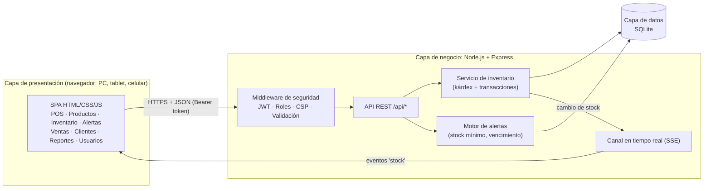
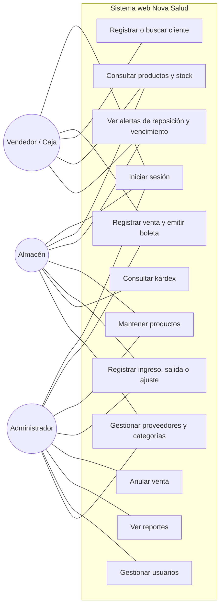
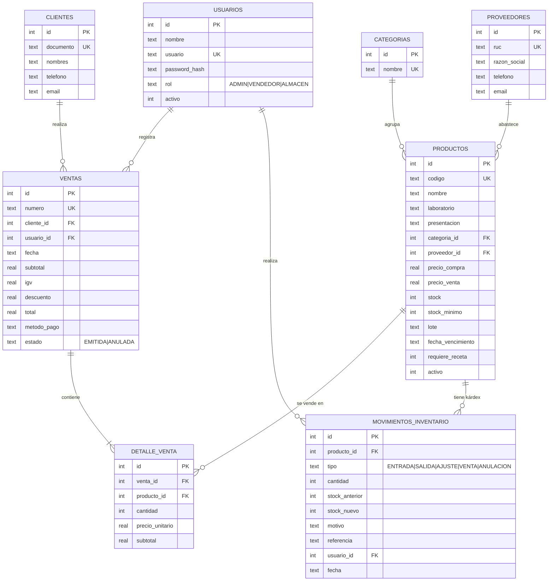
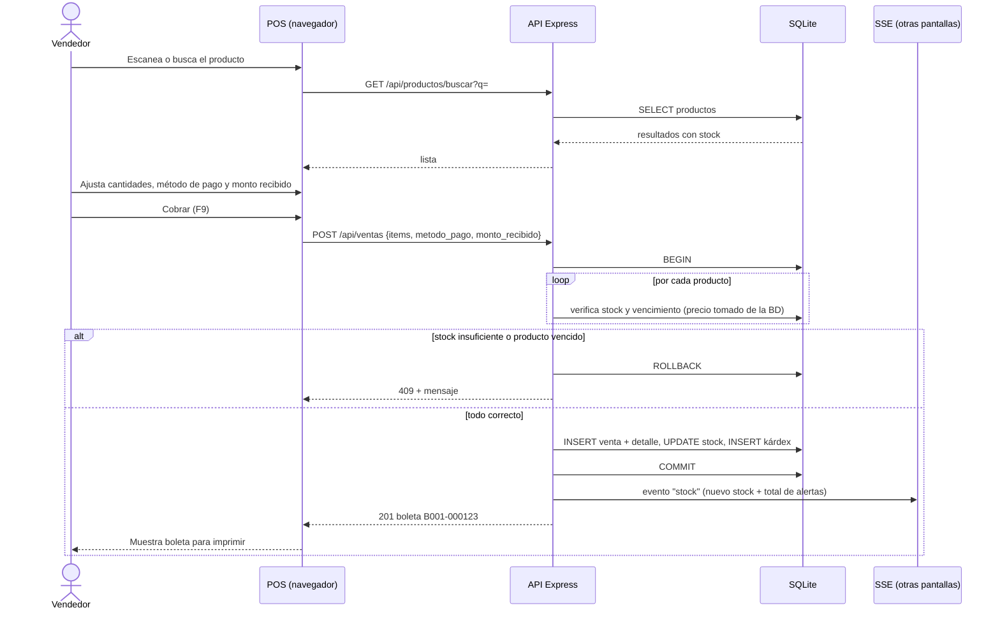
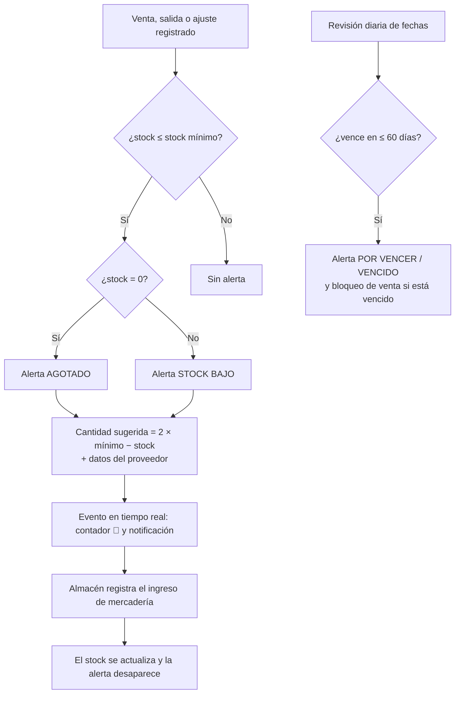
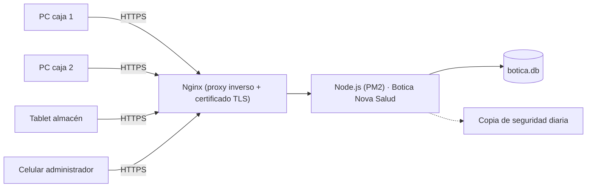

# Informe del trabajo final: software web de gestión de inventario y venta de la botica "Nova Salud"

**Curso:** Fullstack Developer Software (SENATI)
**Tema:** Implementación de un software web de gestión de inventario y venta de una botica

---

## 1. Descripción del caso

La botica **"Nova Salud"** está en una zona comercial con alta demanda y su número de clientes crece de forma sostenida. Hoy el control de stock y la atención se hacen **manualmente**, lo que provoca:

- errores en el inventario (cuadernos, hojas de cálculo desactualizadas);
- **desabastecimientos frecuentes**, porque nadie se entera a tiempo de que un producto se está acabando;
- **largos tiempos de espera**, porque buscar el producto, calcular el total y anotar la venta toma mucho tiempo.

**Objetivo de la solución:** implementar un software web que centralice y automatice el inventario, las ventas y la atención al cliente. Debe actualizar el stock en tiempo real, alertar automáticamente sobre la reposición, registrar las ventas y ofrecer una interfaz que agilice la atención.

### Cumplimiento de las condiciones del caso

| Condición o requisito | Cómo lo resuelve el sistema |
|---|---|
| Accesible desde dispositivos web | Aplicación web *responsive*: funciona en PC, tablet y celular con cualquier navegador moderno. |
| Seguridad en los datos | Inicio de sesión con JWT, contraseñas cifradas con bcrypt, permisos por rol, validación de todos los datos en el servidor, consultas parametrizadas (contra inyección SQL), escape de HTML (contra XSS), cabeceras CSP, bloqueo tras 5 intentos fallidos y transacciones atómicas. |
| Módulo de alertas de reposición | Módulo **Alertas**: stock ≤ mínimo, agotados y productos por vencer o vencidos. Muestra un contador en vivo en la barra superior, notificaciones emergentes y la cantidad sugerida a pedir. Permite exportar el pedido en CSV. |
| Interfaz intuitiva que reduzca el tiempo de atención | **Punto de venta** con búsqueda instantánea, lector de código de barras (Enter), atajos de teclado (F2, F4, F9), cálculo automático de IGV y vuelto, registro rápido de clientes y boleta imprimible. |
| Gestión centralizada de inventario, ventas y atención | Una sola base de datos y un solo sistema. Todos los usuarios ven la misma información al instante gracias al canal en tiempo real (SSE). |
| Sistema de registro de ventas | Boletas numeradas (B001-000001…), detalle por producto, historial con filtros, reimpresión, anulación controlada y reportes. |
| Reducir errores en el inventario | El stock **solo** cambia mediante ventas o movimientos registrados, y cada cambio queda en un **kárdex** auditable. Las ventas son transaccionales: no se puede vender más de lo que hay ni productos vencidos. También hay ajustes por conteo físico. |

---

## 2. Respuestas a las preguntas guía

> Nota: el enunciado de las preguntas guía menciona "FarmaPlus", pero el caso práctico trata sobre la botica "Nova Salud". Las respuestas se aplican a la botica del caso.

### 2.1 ¿Cuáles son los principales desafíos operativos por la falta de un sistema automatizado?

1. **Desabastecimiento.** Sin un control del stock mínimo, los productos se agotan sin aviso y se pierden ventas y clientes.
2. **Errores de inventario.** Los registros manuales generan diferencias entre el stock anotado y el real: olvidos al anotar ventas, errores de suma, hurtos o mermas no registradas.
3. **Pérdidas por vencimiento.** Sin control de lotes ni fechas de vencimiento, los productos caducan en el anaquel. Además, vender un producto vencido implica un riesgo sanitario.
4. **Atención lenta.** Buscar precios, verificar existencias y calcular totales a mano produce colas y clientes insatisfechos.
5. **Falta de información para decidir.** No se sabe qué se vende más, en qué días ni cuánto se gana, así que las compras se hacen "a ojo".
6. **Falta de trazabilidad y control.** No se puede saber quién vendió, quién modificó el stock ni cuándo lo hizo.
7. **Errores en cobros y comprobantes**, como el cálculo del IGV, el vuelto o boletas ilegibles.

### 2.2 ¿Qué características específicas debe incluir el software?

**Control de stock:**
- Catálogo de productos con código, laboratorio, presentación, categoría, proveedor, precio de compra y de venta, **stock mínimo**, **lote** y **fecha de vencimiento**, y la marca "requiere receta".
- Registro de **ingresos** (con guía o factura, lote y costo), **salidas** (mermas, vencidos) y **ajustes** por inventario físico.
- **Kárdex** por producto (stock anterior, cantidad, stock nuevo, usuario y fecha).
- **Alertas automáticas** de stock bajo o agotado y de vencimiento próximo, con sugerencia de pedido.
- Actualización del stock **en tiempo real** en todas las pantallas.

**Atención al cliente:**
- **Punto de venta** rápido: búsqueda por nombre o código, lector de barras y atajos de teclado.
- Validación instantánea de stock y bloqueo de productos vencidos.
- Aviso al vendedor cuando el producto requiere receta.
- Varios medios de pago (efectivo, tarjeta, Yape, Plin) y cálculo del vuelto.
- **Boleta** con IGV desglosado, imprimible en ticketera.
- Registro de clientes por DNI/RUC e historial de compras.

**Gestión:** usuarios con roles, reportes de ventas, panel de indicadores y exportación a CSV.

### 2.3 ¿Cómo impacta el software en la reducción del desabastecimiento y en la mejora del servicio?

- **Menos desabastecimiento:** cuando un producto llega a su stock mínimo, el sistema lo alerta **en el mismo momento de la venta** (contador y notificación en vivo) e indica cuánto pedir y a qué proveedor. Así la reposición pasa de ser reactiva (cuando el cliente pide algo que ya no hay) a ser **preventiva**.
- **Menos pérdidas por vencimiento:** la alerta de 60 días permite rotar o promocionar los productos antes de que caduquen.
- **Atención más rápida:** buscar, cobrar y emitir la boleta toma segundos. Se evitan búsquedas físicas innecesarias, porque el vendedor ve el stock en pantalla antes de ir al anaquel.
- **Más confianza del cliente:** precios exactos, boleta clara y la seguridad de que no se le venderá un producto vencido.
- **Inventario confiable:** como cada unidad que sale queda registrada, el stock del sistema coincide con el físico, y los ajustes periódicos detectan y explican las diferencias.

### 2.4 ¿Qué beneficios adicionales podría ofrecer el software para aumentar la competitividad?

1. **Inteligencia de negocio:** reportes de productos más vendidos, ventas por día, por vendedor y por medio de pago, y utilidad estimada. Sirven para negociar mejores precios con los proveedores y comprar lo que realmente rota.
2. **Fidelización:** con el historial de compras se pueden lanzar programas de puntos, descuentos o recordatorios de tratamientos crónicos.
3. **Pagos digitales** (Yape, Plin, tarjeta), que hoy son una exigencia del cliente peruano.
4. **Escalabilidad:** al ser web, se puede ampliar a varias sedes, a ventas por WhatsApp o web con *delivery*, y a facturación electrónica SUNAT.
5. **Cumplimiento sanitario:** control de lotes y vencimientos, y de los productos con receta (útil ante inspecciones de DIGEMID).
6. **Control interno:** roles, auditoría de movimientos y anulaciones con motivo, que reducen fraudes y mermas.
7. **Imagen profesional** y menor dependencia de personas clave, porque la información está en el sistema y no en la memoria de un empleado.

### 2.5 ¿Qué métricas permiten evaluar la efectividad del software?

| Métrica (KPI) | Fórmula o fuente | Meta sugerida |
|---|---|---|
| Tiempo promedio de atención por cliente | Desde que llega el cliente hasta que se emite la boleta (cronometrado antes y después de implementar) | Reducirlo ≥ 50 % |
| Ventas por hora en hora punta | N° de boletas / horas (reporte de ventas) | Aumentarlo |
| Tasa de quiebre de stock | Productos agotados / productos activos (panel de alertas) | < 2 % |
| Ventas perdidas por falta de stock | Pedidos no atendidos registrados | Reducirlo ≥ 70 % |
| Exactitud del inventario | 1 − (Σ\|diferencias en ajustes\| / stock total) (kárdex, tipo AJUSTE) | ≥ 98 % |
| Mermas por vencimiento | Unidades dadas de baja por vencimiento / unidades vendidas | Reducirlo |
| Errores en ventas | Ventas anuladas / ventas totales | < 1 % |
| Rotación de inventario | Costo de lo vendido / valor promedio del inventario | Aumentarla |
| Ticket promedio | Monto vendido / N° de ventas (panel) | Aumentarlo |
| Satisfacción del cliente | Encuesta breve o NPS | ≥ 8/10 |

---

## 3. Propuesta de solución

### 3.1 Arquitectura

Arquitectura **cliente-servidor en tres capas**: presentación (SPA en el navegador), lógica de negocio (API REST en Node.js/Express) y datos (SQLite).

### 3.2 Casos de uso y roles

| Módulo | ADMIN | VENDEDOR | ALMACEN |
|---|:-:|:-:|:-:|
| Panel de control | ✔ | ✔ | ✔ |
| Punto de venta | ✔ | ✔ | — |
| Productos (consultar / editar) | ✔ / ✔ | ✔ / — | ✔ / ✔ |
| Inventario y kárdex | ✔ | — | ✔ |
| Alertas | ✔ | ✔ | ✔ |
| Ventas (historial) | ✔ (todas) + anular | ✔ (propias) | — |
| Clientes | ✔ | ✔ | — |
| Proveedores y categorías | ✔ | — | ✔ |
| Reportes | ✔ | — | — |
| Usuarios | ✔ | — | — |

### 3.3 Modelo de base de datos (entidad-relación)

El script completo está en [`base_datos.sql`](base_datos.sql).

### 3.4 Flujo de una venta (diagrama de secuencia)

### 3.5 Flujo del módulo de alertas

### 3.6 Seguridad aplicada

| Riesgo | Control implementado |
|---|---|
| Acceso no autorizado | Login con JWT (expira en 8 h). Todas las rutas `/api` exigen token. |
| Robo de contraseñas | Hash bcrypt (factor 10). Nunca se devuelven las contraseñas. |
| Fuerza bruta | Bloqueo de 5 minutos tras 5 intentos fallidos por IP. |
| Escalamiento de privilegios | Middleware `permitir(...roles)` en cada ruta sensible. El vendedor solo ve sus ventas. |
| Inyección SQL | Todas las consultas usan sentencias preparadas con parámetros. |
| XSS | Escape automático de todo dato dinámico en el front-end y Content-Security-Policy `script-src 'self'`. |
| Manipulación de precios | El servidor toma el precio de la base de datos y no confía en el navegador. |
| Inconsistencia de stock | Transacciones `BEGIN IMMEDIATE … COMMIT/ROLLBACK` y restricción `CHECK (stock >= 0)`. |
| Pérdida de trazabilidad | Kárdex inmutable. Bajas lógicas de productos, proveedores y usuarios. Anulaciones con motivo. |
| Exposición de errores | Un manejador central devuelve mensajes genéricos (500) sin detalles internos. |

### 3.7 Despliegue sugerido

- **Local:** un PC de la botica ejecuta `npm start`, y las demás computadoras de la red acceden con `http://IP-del-servidor:3000`.
- **Nube:** un VPS o PaaS con Nginx + HTTPS (Let's Encrypt), la variable `JWT_SECRET` definida y una copia de seguridad diaria del archivo `.db`.

### 3.8 Normas de seguridad y salud en el trabajo, y medio ambiente

- **Ergonomía:** interfaz con alto contraste, tipografía legible y atajos de teclado que reducen movimientos repetitivos del mouse. El personal de caja debe tener pausas activas y una silla y una pantalla a la altura adecuadas.
- **Seguridad eléctrica:** equipos conectados a estabilizador o UPS y cableado ordenado.
- **Medio ambiente:** menos papel, porque los reportes y el kárdex son digitales y se imprime solo la boleta necesaria. Gestión adecuada de los RAEE (residuos de aparatos eléctricos). Menos merma de medicamentos vencidos, que son residuos peligrosos.
- **Protección de datos personales:** cumplimiento de la Ley N.° 29733. Solo se registran los datos mínimos del cliente y el acceso está restringido por roles.

---

## 4. Pruebas

Las pruebas automáticas (`npm test`) verifican:

1. Rechazo de credenciales inválidas y de peticiones sin token.
2. Control de acceso por roles.
3. Registro de una venta con IGV, vuelto, agrupación de productos repetidos y descuento de stock.
4. Rechazo de una venta con stock insuficiente sin alterar la base de datos (*rollback*).
5. Bloqueo de la venta de productos vencidos o agotados.
6. Anulación de una venta con devolución del stock.
7. Movimientos de inventario (ingreso, ajuste, salida inválida), alertas y kárdex.
8. Validación de datos de entrada.
9. Indicadores del panel de control.

## 5. Conclusiones

- El sistema reemplaza los procesos manuales por un flujo **centralizado, trazable y en tiempo real**, y ataca directamente las causas del desabastecimiento y de los errores de inventario.
- El **punto de venta** reduce el tiempo de atención gracias a la búsqueda instantánea, el lector de códigos, los atajos y los cálculos automáticos.
- El **módulo de alertas** convierte la reposición en una tarea preventiva y reduce las pérdidas por vencimiento.
- La solución aplica buenas prácticas full stack: API REST, separación en capas, seguridad (JWT, roles, validación, CSP), transacciones y pruebas automatizadas. Además, está lista para crecer hacia la facturación electrónica, varias sedes o la venta en línea.
